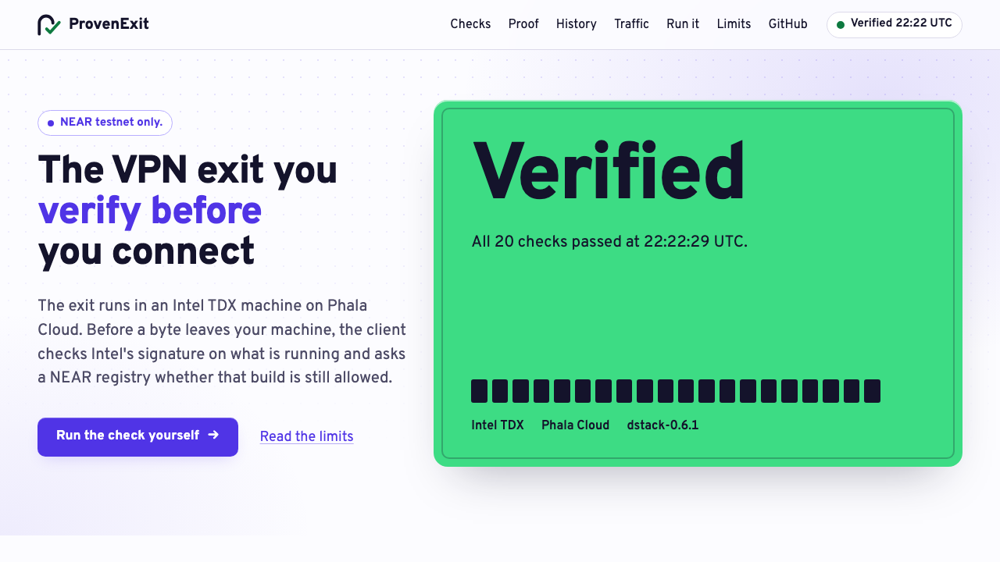

<div align="center">

<picture>
  <source media="(prefers-color-scheme: dark)" srcset="docs/img/logo-dark.png">
  
</picture>

### Every VPN says "no logs". This one proves it.

A VPN exit on Intel TDX whose approved, logging-off build is checked on NEAR before any byte leaves your machine.<br>
Live exit on Phala Cloud · NEAR **testnet only** · MIT

[](deploy/phala/README.md)
[](https://testnet.nearblocks.io/txns/6yBT47ijg4AgqpYGUk6dUw9tdD3kRFw4iScL7aaSBCp)
[](docs/LIMITS.md)
[](https://github.com/erhantrk/provenexit/actions/workflows/tests.yml)
[](https://github.com/erhantrk/provenexit/actions/workflows/verify-exit-image.yml)
[](LICENSE)

[Try it](#try-it-in-2-minutes) · [Verify each claim](docs/VERIFY.md) · [How it works](docs/HOW-IT-WORKS.md) · [Limits](docs/LIMITS.md) · [Reproduce](docs/REPRODUCE.md) · [AI use](AI_USE.md)

</div>

---

ProvenExit is a VPN exit that runs inside an Intel TDX confidential VM, and a client that refuses to send traffic
until an Intel-signed quote proves the exit runs an approved build with logging off. The list of approved builds
lives in a NEAR contract that verifies Intel's attestation on chain; when the owner revokes a build there, the next
connection is refused.

**Why it matters.** Every VPN promises "no logs", and you cannot check it. Here the promise is a measured build:
the hardware signs what is running, a public registry says whether that build is still approved, and your client
checks both before every new connection.

[](https://provenexit.vercel.app)

## Live

| what | where |
|---|---|
| status site | <https://provenexit.vercel.app> (runs the 20 client checks against the live exit) |
| npm | [`provenexit@0.1.5`](https://www.npmjs.com/package/provenexit): `npx provenexit verify` · `inspect` · `connect`; built and published by the [release workflow](.github/workflows/release.yml), files on the [release page](https://github.com/erhantrk/provenexit/releases) |
| MCP server for AI agents | `claude mcp add provenexit -- npx -y -p provenexit provenexit-mcp` |
| exit | Intel TDX on Phala Cloud (`dstack-0.6.1`), running this image since 2026-11-12 20:05 UTC (paused between demo runs; online for judging), image `ghcr.io/erhantrk/provenexit-exit@sha256:74c6d1c5…2785` |
| registry | [`vpnreg.pe-owner-erhan.testnet`](https://testnet.nearblocks.io/address/vpnreg.pe-owner-erhan.testnet): owned by a 2-of-3 council ([`pe-owners.sputnikv2.testnet`](https://testnet.nearblocks.io/address/pe-owners.sputnikv2.testnet), no keys), no access keys, reproducible build, code hash `C1hvenbr…`, source [verified on SourceScan](https://testnet.nearblocks.io/address/vpnreg.pe-owner-erhan.testnet?tab=contract) |
| on-chain registration | [tx `6yBT47ij…`](https://testnet.nearblocks.io/txns/6yBT47ijg4AgqpYGUk6dUw9tdD3kRFw4iScL7aaSBCp): the contract ran all 13 checks on the exit's real quote (186.76 Tgas) |
| live revoke | the owner revoked the running build ([tx `2JJdbyoG…`](https://testnet.nearblocks.io/txns/2JJdbyoGGr5GewNMDd9aeGrDSDjQ33xDoAWWovR8s1u2)): the next connection was refused with `E_COMPOSE_NOT_ALLOWED`; re-allowed ([tx `tdQDjQkF…`](https://testnet.nearblocks.io/txns/tdQDjQkF6ZBVcsxuebHwuvykLEDJ9CvuuVSkicY57LW)), it worked again |

The exit is paid by the hour: it runs through judging and may be stopped afterwards. The offline replay needs no exit.

## Try it in 2 minutes

Check the live exit (Node 22, no accounts):

```sh
npx provenexit verify
```

It prints 20 `✔` lines and `✔ VERIFIED`, then the image digest, compose hash, OS measurement and the on-chain
instance. `npx provenexit connect` then runs a local SOCKS5 proxy on `127.0.0.1:18180` through the exit.

Replay the same exit's attestation offline, from this repo (the replay itself uses no network):

```sh
npm ci && npx tsc -b && node client/dist/cli.js vpn verify --fixture fixtures/live-exit
```

It prints 16 `✔` lines, one `·` line (the replay uses the recorded Intel collateral instead of fetching fresh
collateral) and `✔ VERIFIED (FIXTURE REPLAY …)`.

Every check that needs neither the exit nor NEAR (unit tests, both recorded quotes, the site), in one command, about a
minute; it ends with `JUDGE-OFFLINE: ALL PASS`:

```sh
bash scripts/judge-offline.sh
```

Rebuild the exit image from this checkout and compare it with the digest the exit runs (git and Docker with buildx):

```sh
scripts/verify-exit-image.sh
```

It prints `MATCH`. The same script runs on a GitHub-hosted `linux/amd64` runner on every push to
`main` (the "verify exit image" badge). More, including the full local demo with revocation: [docs/VERIFY.md](docs/VERIFY.md).

## The 20 client checks

In this order, before every new connection, as the client prints them. The first failure refuses the exit.

1. registry contract code hash matches the pinned build (view_account.code_hash) (`E_REGISTRY_CODE_HASH`)
2. response well-formed, fresh 32-byte nonce
3. quote structure (TDX v4)
4. TEE type is TDX
5. pinned root == registry root == verifier root
6. fresh Intel collateral fetched by the client from the PCCS (not the exit's copy) (`E_COLLATERAL_FETCH`)
7. quote signature chain to root
8. Intel TCB status accepted
9. TD debug attribute clear
10. report_data binds the exit's keys
11. report_data binds client nonce as a session quote (SHA256("PLR-v1/session-nonce" ‖ nonce))
12. event log digests and boot sequence
13. event log replays to RTMR3
14. app-compose matches measured compose-hash
15. dstack compose: images pinned by digest, exit logging disabled
16. compose hash allowed by registry
17. OS measurement allowed by registry
18. instance registered with matching keys
19. registry re-check before each connection (compose, OS, instance)
20. destinations resolved by the exit (remote DNS); the client never resolves them

The NEAR contract runs its own 13 checks when the exit registers (DCAP signature and TCB, event log, compose,
allowlists, key binding). The two lists are separate: see [docs/HOW-IT-WORKS.md](docs/HOW-IT-WORKS.md), which also
has the architecture, the two-hop mode and a map of the repository. Specs: [docs/spec](docs/spec).

## Limits

Each one in full in [docs/LIMITS.md](docs/LIMITS.md).

- [NEAR testnet only](docs/LIMITS.md#testnet-only); one live exit.
- [Proxy mode only](docs/LIMITS.md#proxy-mode-only): TCP through SOCKS5, no system-wide tunnel.
- [The usual VPN and TEE caveats](docs/LIMITS.md#usual-vpn-and-tee-caveats): the exit sees destinations, and Intel and Phala are trusted.

## Tracks

Built for the NEAR hackathon (2026-11). Tracks: Privacy & Private AI (main) · AI Security & Defense · Open Innovation

## Prior code

Commits `c2a35e4`..`9bd402e` (2026-10-23/24, before the hackathon started on 2026-11-01) are disclosed prior work:
the mock-root protocol, the NEAR registry, the VPN exit, plus a private LLM router and registries on other chains
that were removed from the tree on 2026-11-12. Their README is
[the baseline README at `9bd402e`](https://github.com/erhantrk/provenexit/blob/9bd402e70b0f909c07f88244d363913f29cc1096/README.md).
The hackathon work is everything after `9bd402e`: the real Intel TDX path (DCAP in the client and on chain, the
dstack event log, the compose policy), the live exit, the reproducible image and the keyless registry
([diff](https://github.com/erhantrk/provenexit/compare/9bd402e...main)). Details: [docs/HISTORY.md](docs/HISTORY.md).

## AI use

Large parts of the code, specs, tests and docs were written with AI coding assistants, directed and reviewed by the
author (design decisions, review, accounts, keys, deployment, submission). Who did
what: [AI_USE.md](AI_USE.md).

## Also by the same author

**ZeroInit**, an independent project that shares no code with this one: <https://github.com/erhantrk/zeroinit>.

## License

MIT, see [LICENSE](LICENSE).
